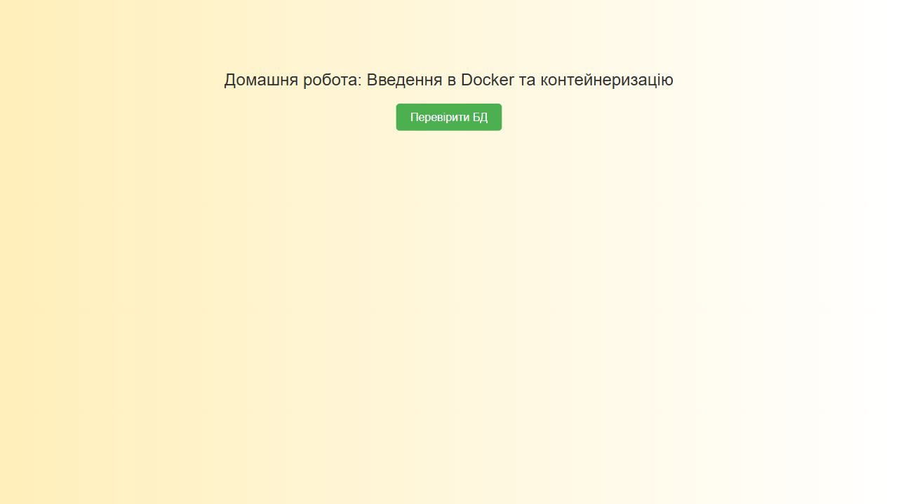
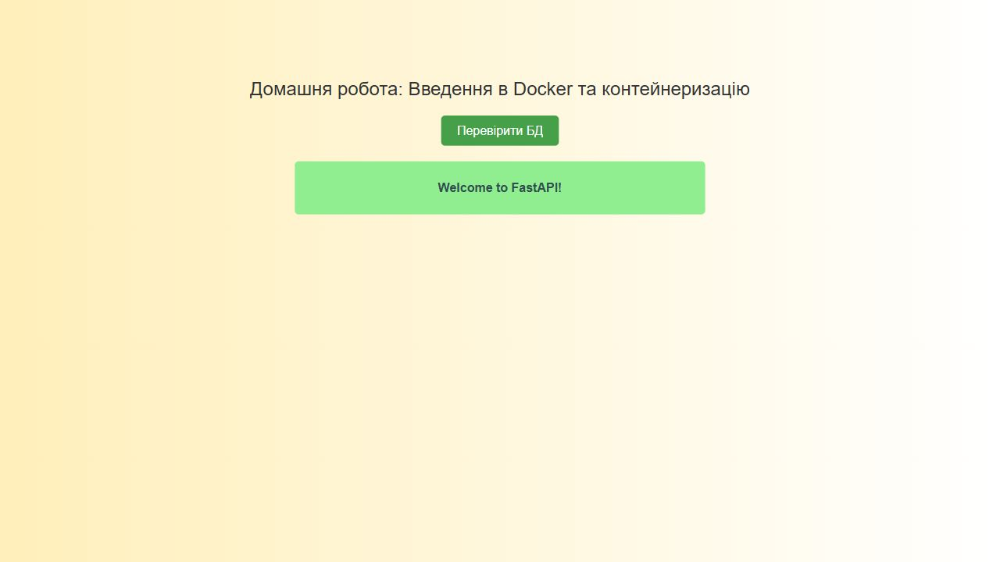

# ДЗ2 — Docker і PostgreSQL

Вихідний FastAPI-застосунок клоновано з офіційного шаблону GoIT. Docker-образ використовує **Python 3.10**. PostgreSQL доступний застосунку як `db:5432`; адреса передається у `SQLALCHEMY_DATABASE_URL` через Compose. Запуск API очікує успішний healthcheck PostgreSQL.

```powershell
Copy-Item .env.example .env
docker compose up --build -d
docker compose ps
```

Відкрийте http://localhost:8002 і натисніть **Перевірити БД**. Очікуваний результат: `Welcome to FastAPI!`. Ця кнопка викликає `/healthchecker`, який виконує `SELECT 1` у PostgreSQL.

```powershell
Invoke-RestMethod http://localhost:8002/healthchecker
docker compose exec app python --version
docker compose logs app
docker compose down
```

Дані PostgreSQL зберігаються у volume `pgdata`. Порт на комп'ютері можна змінити через `APP_PORT`. Пароль із прикладу — лише локальний навчальний; для іншого середовища змініть `.env`.

## Скріншоти роботи застосунку

Головна сторінка запущеного Docker-застосунку за адресою http://localhost:8002:



Після натискання **Перевірити БД** з'являється повідомлення **Welcome to FastAPI!** — застосунок успішно виконав запит до PostgreSQL:



Скріншоти зроблені з працюючого локального застосунку. Оригінальні зображення для завантаження в LMS містяться в папці `screenshots/` і включені в ZIP-архів роботи.
